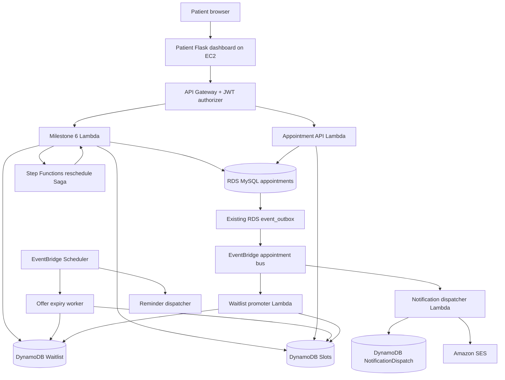

# MediSlot architecture — Milestone 6

The Milestone 6 Lambda currently hosts API handlers and worker operations in one deployable package. RDS is still the durable appointment record; DynamoDB provides conditional concurrency controls. Private interface endpoints provide SSM, EventBridge, Step Functions and SES API connectivity without a NAT Gateway.
