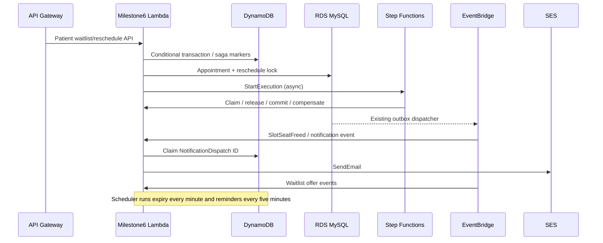

# AWS service and event flow — Milestone 6

Private Lambda traffic reaches SSM, EventBridge, Step Functions and SES through interface VPC endpoints. DynamoDB uses the existing Gateway endpoint. No NAT Gateway is part of the design.
