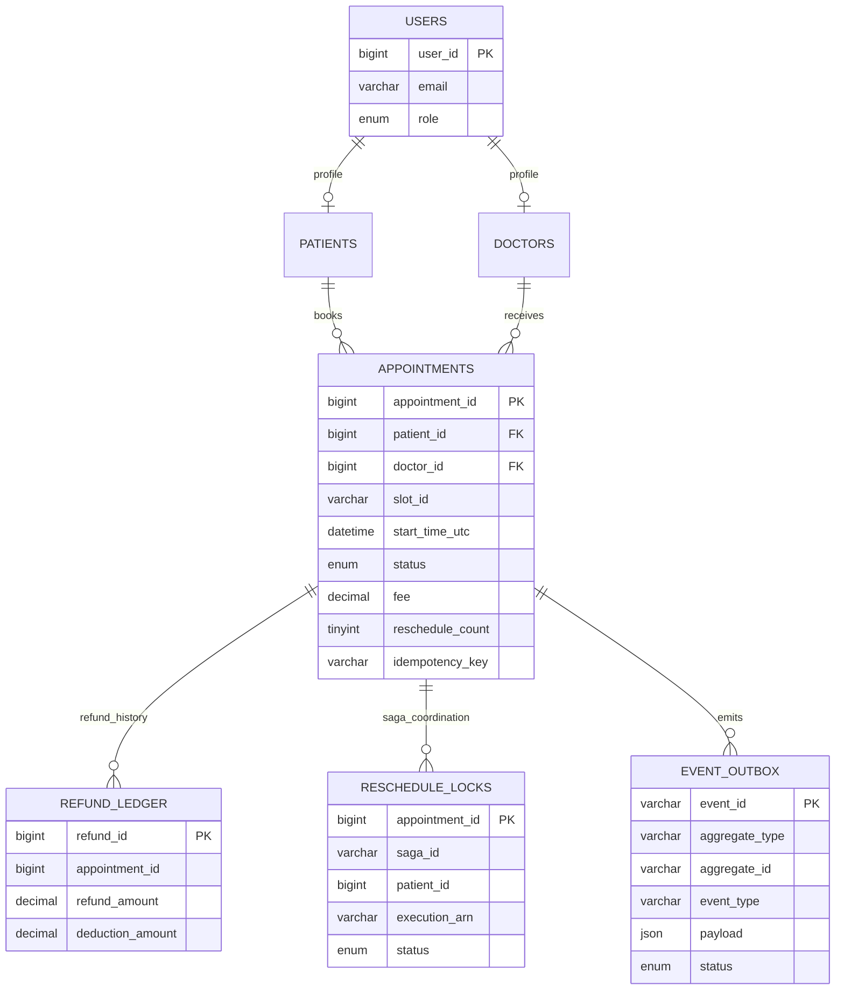

# RDS ERD and schema notes — Milestone 6

`appointments.reschedule_count` is reused and remains capped at 2. The new `reschedule_locks` coordination table has no foreign-key dependency; it serializes the asynchronous Saga against cancellation/outcome updates. Appointment changes and the `AppointmentRescheduled` outbox event are committed in one RDS transaction.
