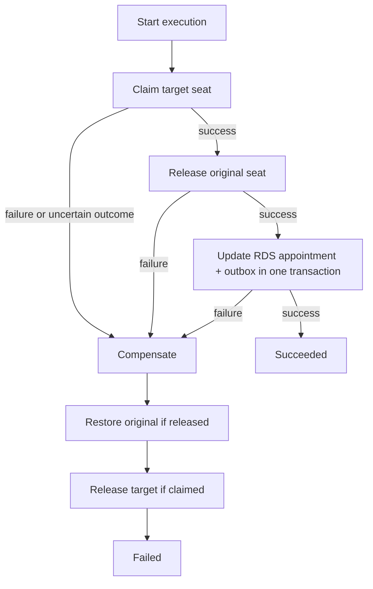

# Reschedule Saga and compensation

The API validates patient ownership, CONFIRMED status, configured attempt limit (2), configured cutoff (6 hours), and target slot date before starting Step Functions asynchronously.

DynamoDB step markers make target claim, original release and compensation idempotent. A deterministic RDS outbox event ID makes the RDS commit retry-safe. The same appointment row is updated; failed attempts do not increment `reschedule_count`.
